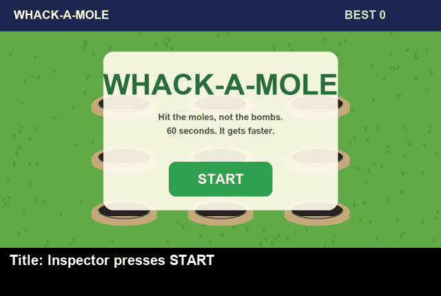
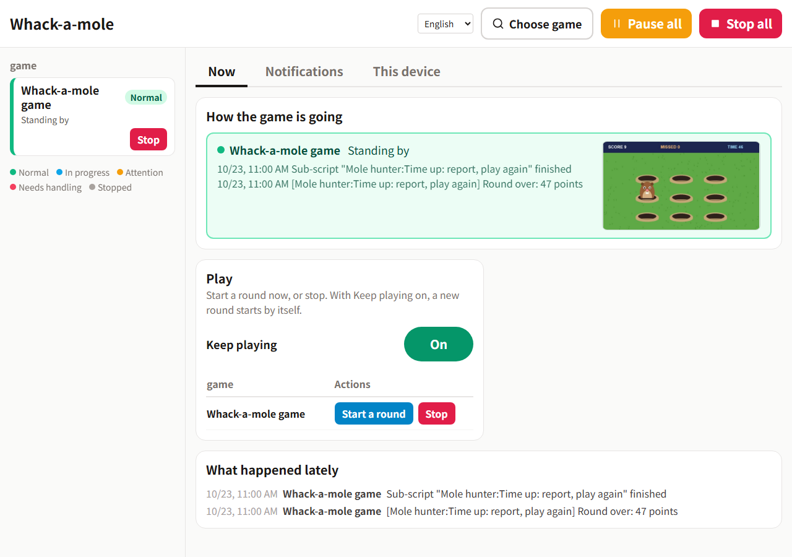

# Inspector demo: whack-a-mole

A small game in a window of its own, to try [Inspector](https://github.com/wrbyhaquc/inspector) on a screen it has to
watch and click quickly. Inspector looks at the window, sees a mole pop up and clicks it - and leaves the bombs alone.
The clicks are sent to the window in the background, so your mouse stays yours.

English · [繁體中文](README.zh-TW.md)



*Nobody touches the mouse in this clip: Inspector watches the game's window and clicks through the pack below.*

## The game

A round lasts 60 seconds. Moles pop up from the nine holes, faster and faster; a click on one scores a point, a mole
that goes down unhit is missed. Now and then a bomb pops up instead: clicking it costs three points. When the time is
up, a card shows the score, the hits, the misses, the bombs hit and the average reaction time, with PLAY AGAIN.

## Run it

Windows (the "App window" source and its clicks are Windows only), Python 3.10+ and Pillow (`pip install pillow`;
Inspector already has it).

```bash
python game/window.py           # a window "Whack-a-Mole - Inspector demo"
```

Options: `--scale` (window size, 1 = 1280x720; default 0.75), `--fps`, `--seed`, `--port` (the state page, default
8820: `http://127.0.0.1:8820/api/state` has the game's own numbers, for checking - Inspector only sees the picture).

Play it yourself first if you like: the mouse works as in any game.

## Try it in 10 minutes

You need [Inspector](https://github.com/wrbyhaquc/inspector) installed (the Runtime is enough: no PyTorch, no model to
train; a version from 23 October 2026 on: older ones capture the window shifted by its title bar and do not know the
pack's run settings) and this repository.

1. **Start the game.** `python game/window.py`. It may sit behind other windows, but **do not minimise it**: a
   minimised window has no picture.
2. **Start Inspector.** `start.bat` (or `python -m server`) in the Inspector folder; it opens http://127.0.0.1:8765.
3. **Install the pack.** **Packs › Install or upgrade**, choose `pack/releases/whack-a-mole-1.0.0.zip`
   (`whack-a-mole-zh-1.0.0.zip` for the Chinese one) and let it become the running pack; restart Inspector when it
   asks. From a command line instead: `python -m project.pack install pack/releases/whack-a-mole-1.0.0.zip --activate`
   in the Inspector folder, then start it.
4. **Check the source.** **Sources** shows *Whack-a-mole game*: the pack brings the window's title, so nothing has to
   be picked.
5. **Run.** **Run › Start**. The pack asks to look every 300 ms and allows up to 60 clicks a minute (Inspector's
   safety limit, 12 by default); the Run page shows both, and what you set there wins. No model: every state is
   judged by screen rules.
6. **Watch.** Two seconds on the title screen and Inspector presses START; then it plays. The **operation panel**
   (**Operation panel ↗**) has *Start a round*, *Stop* and *Keep playing* (a new round by itself after time up), and
   each round's score.



## What is in the pack

| | |
|---|---|
| Source | `MOLE-GAME`: the game's window ("App window"), found by its title, clicked in the background (`project.json` "sources") |
| Run settings | look every 0.3 s, up to 60 clicks a minute (`project.json` "run"; this computer's settings win) |
| States | `screen` (the START / PLAY AGAIN button, reference pictures; neither = playing), `mole1` .. `mole9` (brown fur above each hole; a bomb is black, so it is never a mole), `final_score` (read digits on the card) - `pack/states.json`, the taught references in `pack/refs/` |
| Buttons | `hole_1` .. `hole_9`, `start`, `again`: where to click |
| Main script | *Mole hunter*: a mole in a hole → click that hole; the title → START; time up → tell the score, PLAY AGAIN (both only while *Keep playing* is on) |
| Setting | *Keep playing* |
| Operation panel | the game and how it is going, start a round, stop, keep playing, notifications |

A round played by Inspector: about 40 moles hit, none missed, no bomb hit, a reaction of about 0.55 s (looking every
0.3 s, and a decision is only taken when two looks agree - Inspector is built to be sure rather than quick).

`pack/build.py` makes the pack through Inspector's own API (`--lang en` or `zh-TW`), and `python -m project.pack export`
(in the Inspector folder) turns it into the zip in `pack/releases/`. `tools/teach_refs.py` makes the reference pictures
from the game's drawing; `tools/check_states.py` checks every state against pictures of the game (17,100 answers,
none wrong); `tools/record_gif.py` records the GIF.

## License

Apache-2.0.
