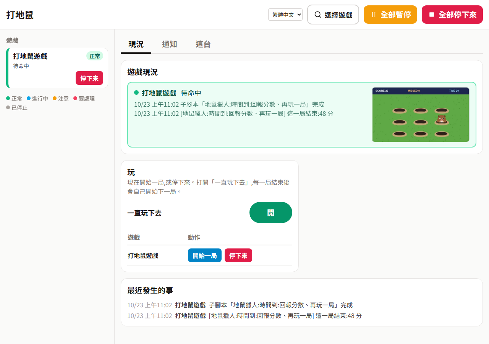

# Inspector 示範:打地鼠

一個開在自己視窗裡的小遊戲,用來試 [Inspector](https://github.com/wrbyhaquc/inspector) 在「要看著畫面、而且要點得快」的情況下表現如何。
Inspector 看著視窗,地鼠一冒出來就點下去,炸彈一個都不碰。點擊是在背景送進視窗的,你的滑鼠照樣可以自己用。

[English](README.md) · 繁體中文


*這段影片裡沒有人碰滑鼠:Inspector 看遊戲視窗的畫面,透過下面的方案包點擊。*

## 遊戲

一局 60 秒。九個洞會冒出地鼠,越來越快;點到一隻得 1 分,沒點到就縮回去算「漏掉」。
偶爾冒出來的是炸彈:點到扣 3 分。時間到會出現成績卡,有分數、命中、漏掉、誤打炸彈、平均反應時間,以及 PLAY AGAIN 按鈕。

## 執行

需要 Windows(「應用程式視窗」來源和它的點擊只支援 Windows)、Python 3.10 以上與 Pillow(`pip install pillow`;裝了 Inspector 就已經有)。

```bash
python game/window.py           # 開出一個「Whack-a-Mole - Inspector demo」視窗
```

參數:`--scale`(視窗大小,1 = 1280x720;預設 0.75)、`--fps`、`--seed`、`--port`(狀態頁,預設 8820:`http://127.0.0.1:8820/api/state` 是遊戲自己的數字,只給你核對用,Inspector 只看畫面)。

想先自己玩也可以,滑鼠就跟一般遊戲一樣用。

## 10 分鐘試用

需要先裝好 [Inspector](https://github.com/wrbyhaquc/inspector)(Runtime 版就夠:不用 PyTorch,也不用訓練模型;要 2026 年 10 月 23 日以後的版本:舊版擷取視窗時會被標題列推歪,也不認得方案包的執行設定),再加上這個 repo。

1. **啟動遊戲。** `python game/window.py`。視窗可以被別的視窗擋住,但**不要縮到最小**:縮到最小的視窗拿不到畫面。
2. **啟動 Inspector。** 在 Inspector 資料夾執行 `start.bat`(或 `python -m server`),會打開 http://127.0.0.1:8765。
3. **安裝方案包。** **方案包 › 安裝或升級**,選 `pack/releases/whack-a-mole-zh-1.0.0.zip`(英文版是 `whack-a-mole-1.0.0.zip`),並設成執行中的方案包;依提示重新啟動 Inspector。
   也可以用指令:在 Inspector 資料夾執行 `python -m project.pack install pack/releases/whack-a-mole-zh-1.0.0.zip --activate`,再啟動。
4. **確認來源。** **來源** 頁會有「打地鼠遊戲」:方案包已經帶好視窗標題,不用自己挑。
5. **開始執行。** **執行 › 開始**。方案包要求每 300 毫秒看一次、每分鐘最多點 60 次(Inspector 的安全上限,預設 12 次);執行頁上看得到這兩個值,你在那裡改的會優先。不需要模型:每個狀態都用畫面規則判斷。
6. **看它玩。** 開始畫面停兩秒後 Inspector 會按 START,接著開始打。**操作面板**(**操作面板(給使用者) ↗**)有「開始一局」、「停下來」、「一直玩下去」(時間到後自己開始下一局),也看得到每一局的分數。



## 方案包裡有什麼

| | |
|---|---|
| 來源 | `MOLE-GAME`:遊戲的視窗(「應用程式視窗」),用標題找到,在背景點擊(`project.json` 的 "sources") |
| 執行設定 | 每 0.3 秒看一次、每分鐘最多點 60 次(`project.json` 的 "run";這台電腦上的設定優先) |
| 狀態 | `screen`(START / PLAY AGAIN 按鈕,參考圖比對;兩個都沒有 = 遊戲中)、`mole1` ~ `mole9`(每個洞上方的棕色毛;炸彈是黑色,永遠不會被當成地鼠)、`final_score`(讀成績卡上的數字):`pack/states.json`,教好的參考圖在 `pack/refs/` |
| 按鈕 | `hole_1` ~ `hole_9`、`start`、`again`:要點的位置 |
| 主腳本 | 「地鼠獵人」:哪個洞有地鼠 → 點那個洞;開始畫面 → 按 START;時間到 → 回報分數、按 PLAY AGAIN(後兩項只在「一直玩下去」打開時) |
| 使用者設定 | 一直玩下去 |
| 操作面板 | 遊戲現況、開始一局、停下來、一直玩下去、通知 |

Inspector 玩一局的成績:大約打中 40 隻,沒有漏掉,沒有誤打炸彈,反應時間約 0.55 秒(每 0.3 秒看一次,而且要連續兩次看到一樣才動作:Inspector 的設計是寧可確定,不求最快)。

`pack/build.py` 透過 Inspector 自己的 API 做出這個方案包(`--lang en` 或 `zh-TW`),再用 `python -m project.pack export`(在 Inspector 資料夾)變成 `pack/releases/` 裡的 zip。
`tools/teach_refs.py` 用遊戲的畫面產生參考圖;`tools/check_states.py` 用遊戲的各種畫面檢查每個狀態(17,100 個答案,沒有錯);`tools/record_gif.py` 錄製動畫。

## 授權

Apache-2.0。
